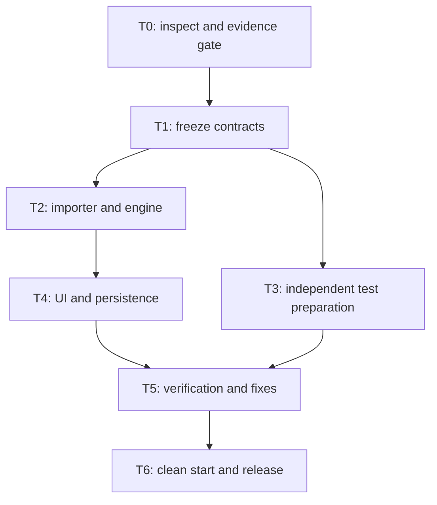
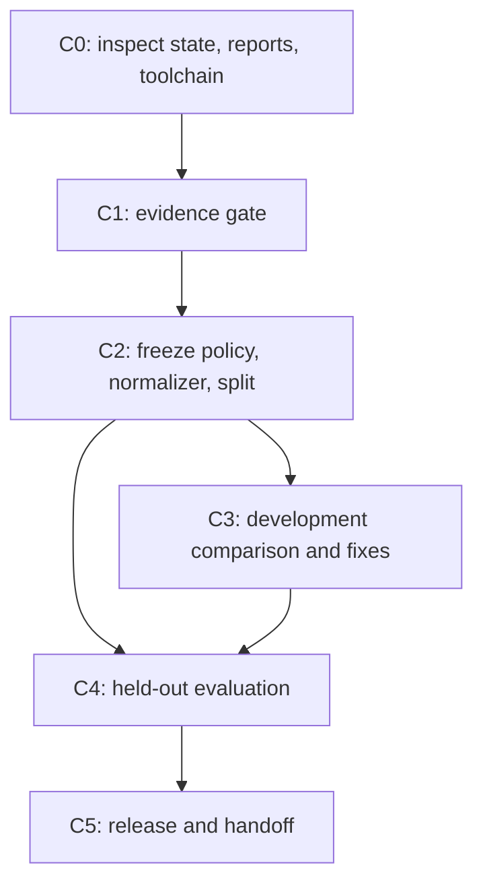

# FormLift: single-launch agent workflow

Status: implementation runbook with one recorded run. Sections 1–10 are the original single-launch contract and still govern any timed run. Section 11 is the continuation workflow for the prototype that now exists: which original tasks are done, which remain, and how a follow-up evidence-first run is recorded without resetting the original timer. Read `IMPLEMENTATION.md` and `reports/` for actual state and deviations. This document itself is not proof of source compatibility. Read [DESIGN.md](DESIGN.md), [PLAN.md](PLAN.md), and [EVIDENCE_AND_TESTS.md](EVIDENCE_AND_TESTS.md) before execution. This file defines orchestration; the design defines interfaces; the evidence protocol defines what a source comparison can prove.

### Recorded run

| Item | Recorded value |
| --- | --- |
| Start / deadline (UTC) | `2026-10-31T04:39:18Z` / `2026-10-31T07:39:18Z`; retained in ignored local state and in `IMPLEMENTATION.md` |
| Implementation revision | `8db15d8` on `main` |
| Tested source fingerprint | `1ab083f5380dd2981e7369861587fb2aba796c3ab0293603d8b99e6a49fdc703` |
| Reference-mode outcome | `BLOCKED_EVIDENCE`: no genuine definition, restoration observation, or response-content capture was supplied |
| Engineering outcome | `npm test` 41/41, `test:e2e` 6/6 real Chromium journeys, clean `npm ci`/`npm test`/`npm start` PASS; classification `SYNTHETIC_ENGINEERING_ONLY` |
| Release gate | `verify:readiness`, `verify:reference`, `verify:release` BLOCKED with exit 2; only issue `MISSING_EVIDENCE` |
| Disclosed deviation | Engineering implementation continued after the failed evidence gate under the user's implementation request; it does not satisfy the minute-20, minute-65, or release gates |

These values describe the original run only. The later merged phases (evidence intake and CI, the hackathon and product upgrades, and the continuation review) record their own fingerprints and counts in `IMPLEMENTATION.md`, and `ROADMAP.md` carries the current status. Any later change to application code, tests, fixtures, scripts, package files, or TypeScript configuration changes the fingerprint and invalidates the reports until the commands are re-run.

## 1. What “one shot” means

One implementation instruction starts a bounded workflow that inspects, designs, implements, tests, fixes, and packages without repeatedly asking the operator to approve routine development decisions. It does not mean one untested generation, unlimited retries, or guaranteed completion in three hours.

The agent can automate repository work and local verification. It cannot manufacture access to the original Typeform, account entitlements, authentic exports, or observations. The strongest uninterrupted run starts with the evidence packet already available. Record preparation time separately; if event rules include it, deduct it from the available budget.

This runbook defaults to **reference mode**. If genuine evidence is missing at minute 20, finish with `BLOCKED_EVIDENCE` and a precise recovery checklist. An explicitly requested **prototype mode** may continue with clearly labelled synthetic inputs, but its output is `PROTOTYPE_ONLY`, not verified reverse engineering. Lack of evidence never silently changes the mode.

## 2. Ready-to-run inputs

| Input | Required for | Ready when |
| --- | --- | --- |
| Working checkout and installed coding agent | Every run | Repository and writable branch are available; existing changes identified |
| Working Node/npm toolchain | Every run | Versions recorded; dependency install works within the budget |
| Available Fable model | Requested coding environment | Agent verifies actual access through its installed client; no invented model name |
| Genuine owned form definition | Reference mode | Original source provenance and sanitized definition are available; routing is included |
| Controlled source observations | Reference claim | Direct paths, abandoned-answer submission, and branch-return restoration are captured or immediately capturable |
| Response-content channel | Submission compatibility claim | Actual wire, stored API/dashboard, or webhook evidence is identified separately |
| Development/held-out split | Independent evaluation | QA controls held-out expectations before the implementer sees them |
| Approved public fixture subset | Publishing evidence | Synthetic/consented inputs, reviewed sanitization, hashes, and transformations recorded |

Do not paste secrets into the launch prompt. Use local ignored files or already configured authorized access. Raw authenticated captures remain private. A response CSV is not a form definition. A synthetic example is not a source export. The README must identify missing prerequisites rather than promising that the agent can acquire them automatically.

When the operator must perform account-only actions, request the exact artifact or observation once, early, and continue independent local setup while waiting. Do not consume the evidence window repeatedly polling an unavailable service. If inputs arrive after the gate, preserve the original deadline; the operator must explicitly reopen the blocked run or authorize a new budget.

## 3. Agent topology and file ownership

Default to a primary **lead/implementer** session and the **formlift-qa** worker. The repository also supplies **formlift-evidence** for a short read-only evidence review. Keep at most three active agents including the lead; finish or stop the evidence worker before using that slot for a final review. A larger team adds coordination work to a small critical path.

The named worker definitions live in `.claude/agents/formlift-evidence.md` and `.claude/agents/formlift-qa.md`; they inherit the parent model. Ask the installed client to use them when its custom-agent capability is available. The runbook does not assume a particular interactive command or programmatic agent API. File ownership below remains mandatory even when a tool technically permits wider writes.

| Role | Owns | Must not do |
| --- | --- | --- |
| Lead/implementer | `src/`, `public/`, package/config files, integration, development evidence manifest, README, license/notices, release decisions | Read held-out outputs before freeze; manufacture observations; change QA expectations to hide failures |
| `formlift-qa` | Assigned `tests/`, comparison runner, test reports; read-only review of source artifacts and manifest | Edit shared engine/UI/server files or captured expectations; claim source behavior from synthetic outputs |
| `formlift-evidence` | Read-only artifact and documentation review; returns observations/proposed experiments to lead | Write files, run account actions, or fabricate evidence |
| Optional reviewer | Read-only diff, contracts, evidence/report review | Add features or start a competing implementation |
| Human operator | Account access, reference interactions, evidence approval, live demonstration | Be treated as an assumed logged-in automation endpoint |

The lead may delegate UI work only after contracts freeze and only by explicitly transferring exclusive ownership of `src/client.ts` and relevant `public/` files. Do not add a UI agent by default. Core changes remain with one owner.

If the client has no subagent feature, perform the same phases sequentially. Keep QA expectations separate and disclose reduced independence. Do not invent a command, YAML agent configuration, or native orchestration feature. These are logical roles that can run through whatever supported tools the installed client actually provides.

## 4. State, handoffs, and resuming

At launch, use the ignored `.formlift/` directory for private run details. Keep `evidence/private/`, `data/`, temporary browser captures, and local credentials ignored too. The public report is a sanitized derivative, not a copy of this private state.

The lead maintains `.formlift/state.json` atomically with:

- Run ID, immutable UTC start and deadline, preparation time, mode, and current phase.
- Base commit, current implementation commit, active branch, uncommitted changes, and contract version/hash.
- Task ID, owner, status (`pending`, `running`, `blocked`, `done`), produced paths, and evidence/report references.
- Source/fixture hashes, required evidence channels, access blockers, and held-out custodian; no tokens or raw response values.
- Last executed commands with exit codes and timestamps, latest failed test identifiers, remaining scope, and next action.
- Completion status and truthful limitations.

This is a small progress record maintained by the agent; do not build a workflow engine or task database. Store the public artifact hashes and detailed reports elsewhere and reference them from state.

Before each handoff, report: task ID, files touched, frozen contract used, commands/results, blockers, and next dependency. Before resuming after interruption, read state and git status, verify the actual files, and compute the remaining time against the original deadline. Do not recreate the start time, assume a tool finished, reuse stale process handles, or rerun a successful destructive step. If the deadline has passed, package existing results and report the limit.

`.formlift/` is ignored, so a fresh clone or a new machine has no state file even when a run is recorded. In that case rebuild `state.json` from the values published in `IMPLEMENTATION.md` and the recorded-run table above: same run ID, same start and deadline, current revision from `git rev-parse HEAD`, and the current source fingerprint. A missing state file is never a reason to record a new start. Note in the rebuilt state that it was reconstructed and from which documents.

Only the lead changes shared contracts. A contract change gets a new version, an explicit reason, and affected test/UI owners are notified before editing continues. No silent interface drift or simultaneous edits to the same files.

## 5. Dependency graph

| Task | Owner | Inputs | Concrete output and exit condition |
| --- | --- | --- | --- |
| T0 | Lead + evidence/QA | Repository, operator artifacts | Recorded access/evidence status; ignores established; reference gate passes or run is blocked |
| T1 | Lead; QA reviews | Actual definition and observations | Supported contract, source-to-model mapping, event/response interfaces, behavior policy with evidence links, normalizer allowlist |
| T2 | Lead | Frozen T1 | Strict importer, pure engine and serializer; one captured history matches before interface work |
| T3 | QA, parallel with T2 | T1 and independent reference data | Development tests, locked held-out expectations, malformed-input cases, source-channel comparison rules |
| T4 | Lead | Working T2 | Import → questionnaire → Back/change → Submit → local persisted record; fixed local routes |
| T5 | QA evaluates; lead fixes | T3 + T4 | Actual type/build/unit/integration/UI/reference results; preserved first held-out report; known failures explicit |
| T6 | Lead; QA verifies | Tested subset | Clean install/run, reviewed release files, license/notices, commands, sanitized report, demo script |

The lead can create test scaffolding early but cannot fabricate expected reference outputs. QA can prepare cases before T2 finishes but does not run held-out evaluation until the core revision is recorded. Installation, build configuration, fixture collection, and integration all count toward the clock.

## 6. Clock and stop rules

| Elapsed | Required state | Decision if missing |
| --- | --- | --- |
| 0–20 | Actual definition, restoration observation, actual response-content observation and usable capture channel | `BLOCKED_EVIDENCE` in reference mode; no fake fallback |
| 20–35 | Frozen interfaces, behavior-policy evidence, source normalization, test split | Remove optional behavior; settle one supported case before parallel edits |
| 35–65 | Importer and pure engine; one real replay | Cut cosmetic work and second ending; keep one faithful path |
| 65–100 | Full local import-to-persistence journey | Focus only on integration blockers; no new features |
| 100–140 | Independent comparisons and failure-case tests | Preserve failures; fix supported behavior before expanding scope |
| 140–155 | Clean-start check and readable report | Use simpler presentation; retain evidence and reproducibility |
| 155–180 | Feature freeze, release review, demonstration | Deliver proven subset and unresolved issues at the deadline |

At minute 60 check for one executable replay; at minute 90 check that integration is on course. Time checkpoints are decisions, not a requirement to idle until the next boundary. Work can finish early.

For a failed test, identify the first causal failure, change the smallest relevant code, rerun that test, then rerun affected suites. Allow at most two targeted repair attempts per blocker before reassessing scope/time. Do not repeat unchanged commands indefinitely. Environment/network failures get one documented alternative within five minutes; otherwise mark the affected check blocked. Limits are recovery rules, not permission to ignore a required failure and claim success.

If a supported behavior fails after the repair budget, either remove that behavior from the declared subset with an explicit contract change and re-run the remaining affected tests, or report failure. Do not shrink the subset after observing holdout failures and present the remaining results as unbiased evaluation. Keep the original failed evaluation visible.

## 7. Verification sequence and command contract

These commands are implemented. Use their actual reports and exits; zero genuine reference cases must remain BLOCKED. Keep scripts small and avoid adding a framework merely to satisfy command names.

| Order | Command/check | Required meaning |
| --- | --- | --- |
| 1 | Manual/tool preflight | Inspect runtime, git state, available inputs, and actual agent capabilities before installing |
| 2 | `npm ci` | Reinstall exact locked dependencies after initial package/lock creation |
| 3 | `npm run verify:readiness` | Classify actual inputs/evidence and environment; captured-fixture execution needs no source token |
| 4 | `npm run typecheck` | TypeScript interfaces and source compile checks |
| 5 | `npm run build` | Build the actual browser/server artifacts used in the demonstration |
| 6 | `npm test` | Unit, parameterization, and HTTP/storage integration tests; genuine and synthetic fixtures labelled |
| 7 | `npm run verify:reference` | Channel-specific comparisons against genuine captured expectations; zero evidence is blocked |
| 8 | `npm run test:e2e` | Browser upload → branch → Back → submit → persisted result; only if browser tooling is available |
| 9 | `npm run verify:reproducibility` | Fresh copy, `npm ci`, `npm test`, `npm start`, one saved response read back; writes `reports/reproducibility.json` |
| 10 | `npm run verify:release` | Aggregate actual reports and release files; cannot manufacture missing test evidence |

The readiness, reference, and release scripts use exit 0 for all required checks passing, 1 for actual mismatch/error, and 2 for missing prerequisite or incomplete required verification. Standard build/test commands retain their normal nonzero failure behavior. The report records the status as well as the exit code.

Implemented options that the continuation relies on: the three `verify:*` commands accept `-- --manifest <path relative to the repository>` so a package can stay under ignored `evidence/private/` until it is reviewed; without the flag they look for `evidence/public/manifest.json`. `test:e2e` honours `CHROMIUM_EXECUTABLE_PATH` when the standard Playwright download is unavailable and records the actual browser version. Every executed reference run also writes a timestamped `reports/reference-<timestamp>.json` next to the latest `reports/reference.json`. The recorded toolchain is Node 24.22.1 and npm 11.9.0 with `engines.node >= 24`; a session on another Node major must re-run the engineering commands rather than cite the recorded reports.

If automated browser setup is unavailable within the bounded setup window, `test:e2e` records BLOCKED rather than PASS. Execute the manual browser checklist only when an operator/browser surface is available, record `PASS_MANUAL` separately, and disclose that automated E2E remains blocked. The full automated release gate remains BLOCKED when automated E2E is missing; a manually verified local demonstration is delivered and labelled separately. If neither is possible, do not claim an end-to-end browser demonstration. A `test:integration` alias may be exposed for convenience, but `npm test` must include the HTTP/storage checks rather than silently omit them.

Run the held-out comparison after recording the frozen engine revision. Preserve first-run results. A case used to fix implementation becomes a regression case; obtain fresh unseen cases if claiming another held-out evaluation. Local synthetic test success and source agreement are different totals.

For a clean-start check, use a fresh temporary checkout/directory or equivalent reproducible environment, preserve user files, and install from the lockfile. A server that only works in the developer's running process is insufficient. Do not erase unrelated work to simulate cleanliness.

## 8. Evidence and completion statuses

| Status | Required basis |
| --- | --- |
| `VERIFIED_SUBSET` | Genuine definition; minimum distinguishing histories captured; all required comparisons pass for the explicitly claimed channels; local engineering and automated browser acceptance pass; reproducible release files present |
| `PARTIAL_REFERENCE` | Some source-backed behavior works, but required comparison channels/cases or automated release acceptance remain missing or failing; list each gap and any separate `PASS_MANUAL` demonstration |
| `PROTOTYPE_ONLY` | Explicit prototype mode; synthetic/local behavior works without enough genuine source evidence; no reverse-engineering or source-fidelity claim |
| `BLOCKED_EVIDENCE` | Reference mode cannot obtain the inputs needed at its evidence gate |
| `FAILED_OR_TIMED_OUT` | Required local behavior remains broken or the deadline stops work before an acceptable deliverable |

The minimum distinguishing histories are direct Yes, direct No, changed-branch submission, and branch return/restoration. Ten histories remain the target in the evidence plan; report the actual development/held-out counts. `VERIFIED_SUBSET` is not a statistical generalization, a production-readiness claim, or proof of all Typeform behavior. Missing channels remain UNVERIFIED even if another channel passes.

The final report states the implementation revision, source and fixture hashes, supported features, observations versus inferences, exact command outcomes, automated versus manual checks, first held-out results, repaired regression results, unsupported inputs, resource measurements, preparation/build time, and unproven claims. Never substitute a polished screenshot for these results.

The recorded run maps to this table as `BLOCKED_EVIDENCE` for the reference-mode work order. The engineering prototype delivered alongside it is reported separately as `SYNTHETIC_ENGINEERING_ONLY` in the generated reports; it is not `PROTOTYPE_ONLY`, because prototype mode was never explicitly requested, and it is not `PARTIAL_REFERENCE`, because no source-backed behavior exists. A later run that supplies evidence produces its own status; it does not upgrade the recorded one.

## 9. Repository and release behavior

On an explicit implementation launch, create an isolated feature branch or worktree, preserve unrelated work, and make reviewable commits. Use the user's existing repository permissions for authorized pushes and a draft implementation PR when requested in the launch instruction. If remote access is unavailable, finish locally and report the unpushed state; do not abandon the local deliverable.

Do not merge the future implementation, deploy publicly, purchase services, or expose private fixtures merely because the coding workflow is autonomous. Those actions are outside this implementation runbook unless separately authorized. No issue assignments, reviewer requests, or messages to people are necessary for this workflow.

Review the actual installed dependency licenses before selecting the proposed MIT code license. Add setup/run/test instructions, a sanitized example, the limitations, and the 90-second demo script. Keep raw source captures, private holdout data before evaluation, secrets, local runtime responses, and private run state out of the public diff.

## 10. One prompt to launch implementation

Use [START_HERE.md](START_HERE.md) for the prerequisite checklist and paste the canonical [PROMPT.md](PROMPT.md) into Claude Code opened at this repository. Keep one authoritative launch prompt rather than copying diverging versions across documents. Reading the documentation alone does not start implementation.

The launch instruction must explicitly activate reference mode, set the original 180-minute deadline, require this runbook and the design, authorize routine implementation/testing/fixes and reviewable branch commits, and specify whether push/draft-PR creation is authorized. It must retain the evidence gate, exclusive file ownership, exact verification reports, feature freeze, and no automatic merge or deployment of implementation.

If a synthetic prototype is intentionally desired despite missing evidence, change the mode before launch through an explicit user instruction and require `PROTOTYPE_ONLY` labeling throughout. The default is `allowPrototype=false`; lack of evidence does not grant permission to change it. A prototype result is a different outcome, not a successful reference-mode run.

With a prototype already in the repository, a new session does not use this launch prompt to rebuild. It uses the continuation instruction in [START_HERE.md](START_HERE.md) and follows section 11.

## 11. Continuation workflow for the implemented prototype

The recorded run delivered a working local prototype and no source evidence. This section tells a later session which parts of the original graph still apply and how to proceed without rewriting the recorded history. The rules in sections 1–9 stay in force; this section only maps them onto the current state.

### 11.1 Run boundaries

- **Same run.** Work on the same work order before the recorded deadline belongs to the recorded run. Rebuild the missing state file as described in section 4; compute remaining time from the recorded start, not from the session start.
- **After the deadline.** The recorded run is closed with the outcome in the table above. Do not append work to it and present the result as within budget. Package, report, and stop that run.
- **Continuation run.** An evidence-first follow-up is a separate run only when the operator explicitly authorizes a new budget. It gets its own run ID, immutable UTC start and deadline, and a preparation entry that discloses the earlier planning and implementation time. It produces its own outcome and cannot relabel the recorded one.
- **Mode.** A continuation defaults to reference mode. If genuine evidence is still absent at its own minute 20, it ends `BLOCKED_EVIDENCE` and leaves the prototype unchanged. Engineering-only maintenance such as dependency updates, test repairs, or documentation is ordinary repository work; it is not a reference run and must not be reported as one.

### 11.2 Original tasks against the recorded state

| Original task | Recorded state | Continuation treatment |
| --- | --- | --- |
| T0 evidence gate | Not passed; no definition, restoration observation, or response-content capture | Must pass from a genuine package before anything else (C1) |
| T1 frozen contracts | Model, event, API, storage, and comparison contracts implemented; behavior policy is the synthetic default `engineering-retain-active-v1` | Policy and normalizer are re-frozen from observations (C2); other contracts change only with a version bump and a recorded reason |
| T2 importer and engine | Implemented; synthetic replays pass | Reused; edited only to fix an observed divergence (C3) |
| T3 independent tests | Engineering suites exist; no independent source expectations | Expected data transcribed by QA or the operator from captures, never produced by running FormLift (C2) |
| T4 UI and persistence | Implemented; six browser journeys pass | Reused; re-run after any application change |
| T5 verification | Engineering PASS; reference comparison never executed | Reference comparison runs for the first time (C3, C4) |
| T6 release | Clean install PASS; release gate BLOCKED | Release gate re-run with evidence present (C5) |

### 11.3 Continuation graph

| Task | Owner | Exit condition |
| --- | --- | --- |
| C0 | Lead | `git status` read and unrelated local changes preserved; current source fingerprint compared with the fingerprint in each report; Node and npm versions compared with the recorded toolchain. Stale or mismatched reports are re-run, never cited. |
| C1 | Operator supplies; `formlift-evidence` reviews; lead records | Package placed under `evidence/private/` in the [REFERENCE_FORMAT.md](REFERENCE_FORMAT.md) layout. `npm run verify:readiness -- --manifest <path>` exits 0, and the evidence review confirms the named channels and that the cases discriminate the competing hypotheses. Exit 2 ends the run `BLOCKED_EVIDENCE`. Exit 1 means an invalid package: return it to the operator with the bounded diagnostics; the lead does not edit captures to make it validate. |
| C2 | Lead; QA or operator as held-out custodian | Restoration and submission policy set from the observations and recorded with case IDs. If the observed combination is not one the implementation supports, record a contract change and implement it; never force the manifest into an inaccurate policy. Development and held-out split locked and hashed. Held-out expected files stay outside the lead's context. |
| C3 | Lead fixes; QA re-runs | `npm run verify:reference` on development cases. Each divergence gets at most two targeted repairs in `src/` under the section 6 rules. Expected artifacts are never edited to match. `npm test` and `npm run test:e2e` return green after each fix, and the engine revision used for C4 is recorded. |
| C4 | QA | One run against the recorded frozen revision. The timestamped `reports/reference-<timestamp>.json` from that run is kept unchanged. A failing case that later informs a repair is relabelled `regression` in a new manifest version; the earlier manifest and report remain. A second held-out claim needs new unseen captures. |
| C5 | Lead; QA verifies | `npm run verify:release` result recorded as it is. `IMPLEMENTATION.md` validation table, README status, recorded-run table, and `reports/` updated to the new revision and fingerprint. A public manifest is published only after sanitization review. Reviewed files committed; draft PR if a remote exists, otherwise the unpushed state is reported. |

When the continuation is a timed run, apply the section 6 clock: C1 by minute 20, C2 by minute 35, C3 complete with one development case matching by minute 65 and all development cases executed by minute 100, C4 by minute 140, C5 and feature freeze by minute 155, packaging to minute 180. Checkpoints are decisions, not idle time; finishing early is allowed.

### 11.4 Saved workflow script

`.claude/workflows/formlift-continuation.js` encodes C0, C1, C3, and a read-only engineering review as a Claude Code workflow script. It is an orchestration convenience, not a new framework: the roles, ownership, and gates are the ones above.

- **What it runs.** C0 inspection (git state, report fingerprints against the current source, toolchain); C1 as a read-only `formlift-evidence` review followed by `formlift-qa` running `verify:readiness`; C3 as `formlift-qa` running `verify:reference` on development cases only when the gate passed; then four read-only review lenses (engine, server, client, tooling) whose findings each pass one adversarial refuter. It returns the gate status, the reference result if any, and the confirmed findings.
- **What it never does.** No workflow agent edits `src/`, `public/`, `scripts/`, package files, docs, or tests, and none relabels evidence or expected data. Confirmed findings go to the lead, who fixes, re-runs the commands in section 7, and commits. Held-out evaluation (C4) is not automated; QA runs it once against the frozen revision the lead records.
- **Concurrency.** At most two subagents run at a time, so the lead plus workers stay within the three-agent limit in section 3.
- **Arguments.** `startedAt` (ISO timestamp, required because scripts cannot read the clock), optional `manifest` (repository-relative path to a private manifest), `skipEngineering`, and `maxFindingsPerLens` (default 6).
- **Running it.** From a Claude Code session at the repository root, ask for the workflow by name, for example: "Run the formlift-continuation workflow with startedAt set to now." The lead records the continuation run in `.formlift/state.json` first (section 11.1) and keeps that file out of git.

A workflow result with gate status `BLOCKED_EVIDENCE` is the expected outcome while no genuine captures exist. The review findings that follow are ordinary engineering input and do not change that status.

### 11.5 Reporting a continuation

The final report contains everything listed in section 8 plus: the recorded run ID and outcome it follows; the continuation run ID, start, deadline, and disclosed preparation; revision and fingerprint before and after; per-channel coverage with UNVERIFIED channels named; the path of the first held-out report; every regression relabel with its reason. Development pass counts, held-out pass counts, and synthetic engineering test counts are three separate totals and are never summed.

