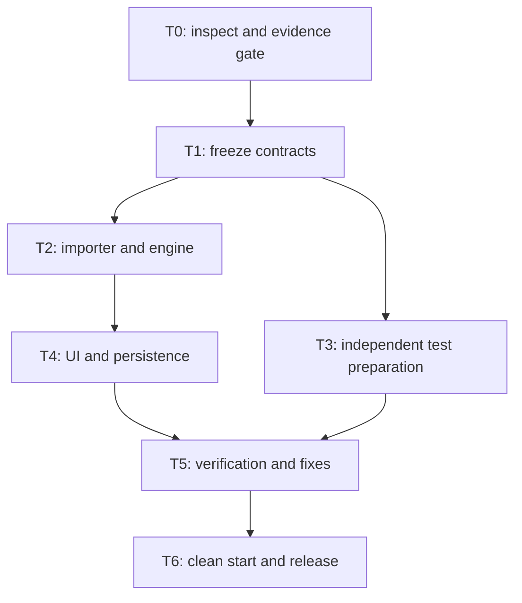

# FormLift: single-launch agent workflow

Status: original implementation runbook. A local engineering prototype is now built; read `IMPLEMENTATION.md` and current reports for actual state and deviations. This document itself is not proof of source compatibility. Read [DESIGN.md](DESIGN.md), [PLAN.md](PLAN.md), and [EVIDENCE_AND_TESTS.md](EVIDENCE_AND_TESTS.md) before execution. This file defines orchestration; the design defines interfaces; the evidence protocol defines what a source comparison can prove.

## 1. What “one shot” means

One implementation instruction starts a bounded workflow that inspects, designs, implements, tests, fixes, and packages without repeatedly asking the operator to approve routine development decisions. It does not mean one untested generation, unlimited retries, or guaranteed completion in three hours.

The agent can automate repository work and local verification. It cannot manufacture access to the original Typeform, account entitlements, authentic exports, or observations. The strongest uninterrupted run starts with the evidence packet already available. Record preparation time separately; if event rules include it, deduct it from the available budget.

This runbook defaults to **reference mode**. If genuine evidence is missing at minute 20, finish with `BLOCKED_EVIDENCE` and a precise recovery checklist. An explicitly requested **prototype mode** may continue with clearly labelled synthetic inputs, but its output is `PROTOTYPE_ONLY`, not verified reverse engineering. Lack of evidence never silently changes the mode.

## 2. Ready-to-run inputs

| Input | Required for | Ready when |
| --- | --- | --- |
| Working checkout and installed coding agent | Every run | Repository and writable branch are available; existing changes identified |
| Working Node/npm toolchain | Every run | Versions recorded; dependency install works within the budget |
| Available Fable model | Requested coding environment | Agent verifies actual access through its installed client; no invented model name |
| Genuine owned form definition | Reference mode | Original source provenance and sanitized definition are available; routing is included |
| Controlled source observations | Reference claim | Direct paths, abandoned-answer submission, and branch-return restoration are captured or immediately capturable |
| Response-content channel | Submission compatibility claim | Actual wire, stored API/dashboard, or webhook evidence is identified separately |
| Development/held-out split | Independent evaluation | QA controls held-out expectations before the implementer sees them |
| Approved public fixture subset | Publishing evidence | Synthetic/consented inputs, reviewed sanitization, hashes, and transformations recorded |

Do not paste secrets into the launch prompt. Use local ignored files or already configured authorized access. Raw authenticated captures remain private. A response CSV is not a form definition. A synthetic example is not a source export. The README must identify missing prerequisites rather than promising that the agent can acquire them automatically.

When the operator must perform account-only actions, request the exact artifact or observation once, early, and continue independent local setup while waiting. Do not consume the evidence window repeatedly polling an unavailable service. If inputs arrive after the gate, preserve the original deadline; the operator must explicitly reopen the blocked run or authorize a new budget.

## 3. Agent topology and file ownership

Default to a primary **lead/implementer** session and the **formlift-qa** worker. The repository also supplies **formlift-evidence** for a short read-only evidence review. Keep at most three active agents including the lead; finish or stop the evidence worker before using that slot for a final review. A larger team adds coordination work to a small critical path.

The named worker definitions live in `.claude/agents/formlift-evidence.md` and `.claude/agents/formlift-qa.md`; they inherit the parent model. Ask the installed client to use them when its custom-agent capability is available. The runbook does not assume a particular interactive command or programmatic agent API. File ownership below remains mandatory even when a tool technically permits wider writes.

| Role | Owns | Must not do |
| --- | --- | --- |
| Lead/implementer | `src/`, `public/`, package/config files, integration, development evidence manifest, README, license/notices, release decisions | Read held-out outputs before freeze; manufacture observations; change QA expectations to hide failures |
| `formlift-qa` | Assigned `tests/`, comparison runner, test reports; read-only review of source artifacts and manifest | Edit shared engine/UI/server files or captured expectations; claim source behavior from synthetic outputs |
| `formlift-evidence` | Read-only artifact and documentation review; returns observations/proposed experiments to lead | Write files, run account actions, or fabricate evidence |
| Optional reviewer | Read-only diff, contracts, evidence/report review | Add features or start a competing implementation |
| Human operator | Account access, reference interactions, evidence approval, live demonstration | Be treated as an assumed logged-in automation endpoint |

The lead may delegate UI work only after contracts freeze and only by explicitly transferring exclusive ownership of `src/client.ts` and relevant `public/` files. Do not add a UI agent by default. Core changes remain with one owner.

If the client has no subagent feature, perform the same phases sequentially. Keep QA expectations separate and disclose reduced independence. Do not invent a command, YAML agent configuration, or native orchestration feature. These are logical roles that can run through whatever supported tools the installed client actually provides.

## 4. State, handoffs, and resuming

At launch, use the ignored `.formlift/` directory for private run details. Keep `evidence/private/`, `data/`, temporary browser captures, and local credentials ignored too. The public report is a sanitized derivative, not a copy of this private state.

The lead maintains `.formlift/state.json` atomically with:

- Run ID, immutable UTC start and deadline, preparation time, mode, and current phase.
- Base commit, current implementation commit, active branch, uncommitted changes, and contract version/hash.
- Task ID, owner, status (`pending`, `running`, `blocked`, `done`), produced paths, and evidence/report references.
- Source/fixture hashes, required evidence channels, access blockers, and held-out custodian; no tokens or raw response values.
- Last executed commands with exit codes and timestamps, latest failed test identifiers, remaining scope, and next action.
- Completion status and truthful limitations.

This is a small progress record maintained by the agent; do not build a workflow engine or task database. Store the public artifact hashes and detailed reports elsewhere and reference them from state.

Before each handoff, report: task ID, files touched, frozen contract used, commands/results, blockers, and next dependency. Before resuming after interruption, read state and git status, verify the actual files, and compute the remaining time against the original deadline. Do not recreate the start time, assume a tool finished, reuse stale process handles, or rerun a successful destructive step. If the deadline has passed, package existing results and report the limit.

Only the lead changes shared contracts. A contract change gets a new version, an explicit reason, and affected test/UI owners are notified before editing continues. No silent interface drift or simultaneous edits to the same files.

## 5. Dependency graph

| Task | Owner | Inputs | Concrete output and exit condition |
| --- | --- | --- | --- |
| T0 | Lead + evidence/QA | Repository, operator artifacts | Recorded access/evidence status; ignores established; reference gate passes or run is blocked |
| T1 | Lead; QA reviews | Actual definition and observations | Supported contract, source-to-model mapping, event/response interfaces, behavior policy with evidence links, normalizer allowlist |
| T2 | Lead | Frozen T1 | Strict importer, pure engine and serializer; one captured history matches before interface work |
| T3 | QA, parallel with T2 | T1 and independent reference data | Development tests, locked held-out expectations, malformed-input cases, source-channel comparison rules |
| T4 | Lead | Working T2 | Import → questionnaire → Back/change → Submit → local persisted record; fixed local routes |
| T5 | QA evaluates; lead fixes | T3 + T4 | Actual type/build/unit/integration/UI/reference results; preserved first held-out report; known failures explicit |
| T6 | Lead; QA verifies | Tested subset | Clean install/run, reviewed release files, license/notices, commands, sanitized report, demo script |

The lead can create test scaffolding early but cannot fabricate expected reference outputs. QA can prepare cases before T2 finishes but does not run held-out evaluation until the core revision is recorded. Installation, build configuration, fixture collection, and integration all count toward the clock.

## 6. Clock and stop rules

| Elapsed | Required state | Decision if missing |
| --- | --- | --- |
| 0–20 | Actual definition, restoration observation, actual response-content observation and usable capture channel | `BLOCKED_EVIDENCE` in reference mode; no fake fallback |
| 20–35 | Frozen interfaces, behavior-policy evidence, source normalization, test split | Remove optional behavior; settle one supported case before parallel edits |
| 35–65 | Importer and pure engine; one real replay | Cut cosmetic work and second ending; keep one faithful path |
| 65–100 | Full local import-to-persistence journey | Focus only on integration blockers; no new features |
| 100–140 | Independent comparisons and failure-case tests | Preserve failures; fix supported behavior before expanding scope |
| 140–155 | Clean-start check and readable report | Use simpler presentation; retain evidence and reproducibility |
| 155–180 | Feature freeze, release review, demonstration | Deliver proven subset and unresolved issues at the deadline |

At minute 60 check for one executable replay; at minute 90 check that integration is on course. Time checkpoints are decisions, not a requirement to idle until the next boundary. Work can finish early.

For a failed test, identify the first causal failure, change the smallest relevant code, rerun that test, then rerun affected suites. Allow at most two targeted repair attempts per blocker before reassessing scope/time. Do not repeat unchanged commands indefinitely. Environment/network failures get one documented alternative within five minutes; otherwise mark the affected check blocked. Limits are recovery rules, not permission to ignore a required failure and claim success.

If a supported behavior fails after the repair budget, either remove that behavior from the declared subset with an explicit contract change and re-run the remaining affected tests, or report failure. Do not shrink the subset after observing holdout failures and present the remaining results as unbiased evaluation. Keep the original failed evaluation visible.

## 7. Verification sequence and command contract

These commands are implemented. Use their actual reports and exits; zero genuine reference cases must remain BLOCKED. Keep scripts small and avoid adding a framework merely to satisfy command names.

| Order | Command/check | Required meaning |
| --- | --- | --- |
| 1 | Manual/tool preflight | Inspect runtime, git state, available inputs, and actual agent capabilities before installing |
| 2 | `npm ci` | Reinstall exact locked dependencies after initial package/lock creation |
| 3 | `npm run verify:readiness` | Classify actual inputs/evidence and environment; captured-fixture execution needs no source token |
| 4 | `npm run typecheck` | TypeScript interfaces and source compile checks |
| 5 | `npm run build` | Build the actual browser/server artifacts used in the demonstration |
| 6 | `npm test` | Unit, parameterization, and HTTP/storage integration tests; genuine and synthetic fixtures labelled |
| 7 | `npm run verify:reference` | Channel-specific comparisons against genuine captured expectations; zero evidence is blocked |
| 8 | `npm run test:e2e` | Browser upload → branch → Back → submit → persisted result; only if browser tooling is available |
| 9 | Clean start and `npm start` | Fresh installation/build/start works; replay the demo fixture without a source token |
| 10 | `npm run verify:release` | Aggregate actual reports and release files; cannot manufacture missing test evidence |

The readiness, reference, and release scripts use exit 0 for all required checks passing, 1 for actual mismatch/error, and 2 for missing prerequisite or incomplete required verification. Standard build/test commands retain their normal nonzero failure behavior. The report records the status as well as the exit code.

If automated browser setup is unavailable within the bounded setup window, `test:e2e` records BLOCKED rather than PASS. Execute the manual browser checklist only when an operator/browser surface is available, record `PASS_MANUAL` separately, and disclose that automated E2E remains blocked. The full automated release gate remains BLOCKED when automated E2E is missing; a manually verified local demonstration is delivered and labelled separately. If neither is possible, do not claim an end-to-end browser demonstration. A `test:integration` alias may be exposed for convenience, but `npm test` must include the HTTP/storage checks rather than silently omit them.

Run the held-out comparison after recording the frozen engine revision. Preserve first-run results. A case used to fix implementation becomes a regression case; obtain fresh unseen cases if claiming another held-out evaluation. Local synthetic test success and source agreement are different totals.

For a clean-start check, use a fresh temporary checkout/directory or equivalent reproducible environment, preserve user files, and install from the lockfile. A server that only works in the developer's running process is insufficient. Do not erase unrelated work to simulate cleanliness.

## 8. Evidence and completion statuses

| Status | Required basis |
| --- | --- |
| `VERIFIED_SUBSET` | Genuine definition; minimum distinguishing histories captured; all required comparisons pass for the explicitly claimed channels; local engineering and automated browser acceptance pass; reproducible release files present |
| `PARTIAL_REFERENCE` | Some source-backed behavior works, but required comparison channels/cases or automated release acceptance remain missing or failing; list each gap and any separate `PASS_MANUAL` demonstration |
| `PROTOTYPE_ONLY` | Explicit prototype mode; synthetic/local behavior works without enough genuine source evidence; no reverse-engineering or source-fidelity claim |
| `BLOCKED_EVIDENCE` | Reference mode cannot obtain the inputs needed at its evidence gate |
| `FAILED_OR_TIMED_OUT` | Required local behavior remains broken or the deadline stops work before an acceptable deliverable |

The minimum distinguishing histories are direct Yes, direct No, changed-branch submission, and branch return/restoration. Ten histories remain the target in the evidence plan; report the actual development/held-out counts. `VERIFIED_SUBSET` is not a statistical generalization, a production-readiness claim, or proof of all Typeform behavior. Missing channels remain UNVERIFIED even if another channel passes.

The final report states the implementation revision, source and fixture hashes, supported features, observations versus inferences, exact command outcomes, automated versus manual checks, first held-out results, repaired regression results, unsupported inputs, resource measurements, preparation/build time, and unproven claims. Never substitute a polished screenshot for these results.

## 9. Repository and release behavior

On an explicit implementation launch, create an isolated feature branch or worktree, preserve unrelated work, and make reviewable commits. Use the user's existing repository permissions for authorized pushes and a draft implementation PR when requested in the launch instruction. If remote access is unavailable, finish locally and report the unpushed state; do not abandon the local deliverable.

Do not merge the future implementation, deploy publicly, purchase services, or expose private fixtures merely because the coding workflow is autonomous. Those actions are outside this implementation runbook unless separately authorized. No issue assignments, reviewer requests, or messages to people are necessary for this workflow.

Review the actual installed dependency licenses before selecting the proposed MIT code license. Add setup/run/test instructions, a sanitized example, the limitations, and the 90-second demo script. Keep raw source captures, private holdout data before evaluation, secrets, local runtime responses, and private run state out of the public diff.

## 10. One prompt to launch implementation

Use [START_HERE.md](START_HERE.md) for the prerequisite checklist and paste the canonical [PROMPT.md](PROMPT.md) into Claude Code opened at this repository. Keep one authoritative launch prompt rather than copying diverging versions across documents. Reading the documentation alone does not start implementation.

The launch instruction must explicitly activate reference mode, set the original 180-minute deadline, require this runbook and the design, authorize routine implementation/testing/fixes and reviewable branch commits, and specify whether push/draft-PR creation is authorized. It must retain the evidence gate, exclusive file ownership, exact verification reports, feature freeze, and no automatic merge or deployment of implementation.

If a synthetic prototype is intentionally desired despite missing evidence, change the mode before launch through an explicit user instruction and require `PROTOTYPE_ONLY` labeling throughout. The default is `allowPrototype=false`; lack of evidence does not grant permission to change it. A prototype result is a different outcome, not a successful reference-mode run.

