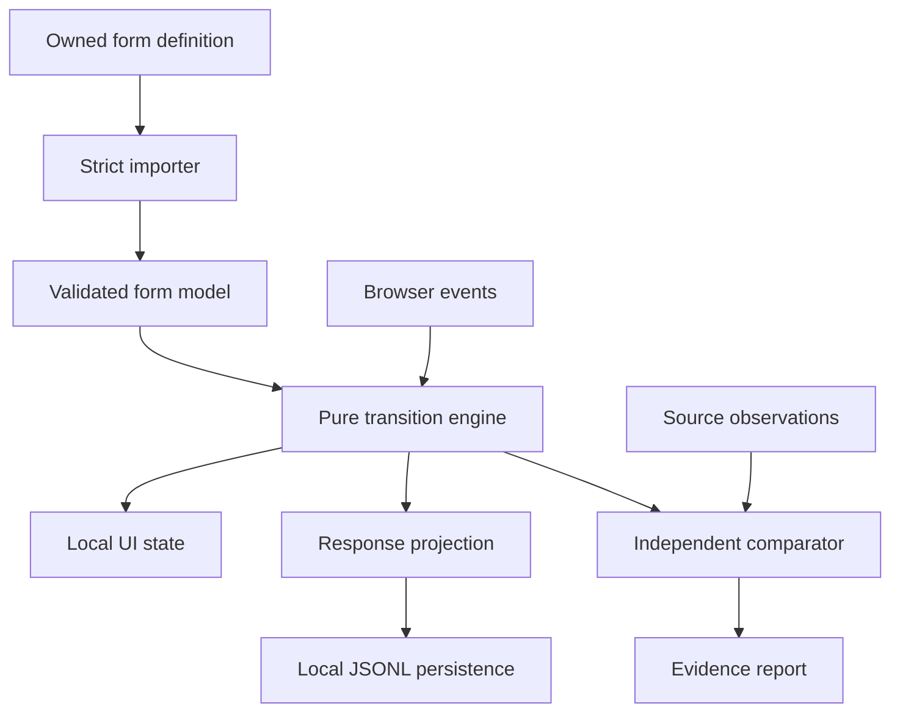

# FormLift technical design

Status: implementation specification; no application or experimental results are implied. This document refines [PLAN.md](PLAN.md) and uses [EVIDENCE_AND_TESTS.md](EVIDENCE_AND_TESTS.md) as the evidence protocol. The implementation budget remains 180 minutes.

## 1. Product contract and evidence boundary

FormLift imports an owned Typeform definition, runs a restricted questionnaire locally, persists its response, and shows which observed behaviors match the source. The useful result is a reproducible migration check, not a visual clone.

The first supported questionnaire has three fields: single-choice Request a quote, conditional numeric Budget, and short-text Contact name. It has one ending. The ceiling is six fields and one captured branch predicate. A second ending is optional only when a real fixture exercises it within the same routing contract.

The implementation must distinguish four facts: what the source documentation specifies; what a controlled source run shows; what we infer from those observations; and what remains unknown. The schema and ordinary routing are publicly documented [S1, S2]. The investigation concerns abandoned-answer restoration and response inclusion.

No source observation is assumed in this document. In particular, do not hardcode that a hidden answer is cleared, retained, submitted, or omitted. UI restoration, the submitted browser payload, a delivered webhook, and a retrieved stored response are separate evidence channels. A match in one channel does not establish another.

### Fixed decisions and decisions deferred to evidence

| Fixed now | Must be frozen from the real artifact/observations by minute 35 |
| --- | --- |
| TypeScript, local Node HTTP server, plain browser UI, file storage | Actual Typeform field/choice/logic mapping |
| Strict supported subset and explicit rejection | Exact predicate/operator and required/default routing |
| Pure transition engine reused for replay and server validation | Source Back behavior at recorded checkpoints |
| Draft input, validated answers, route history, and response projection are separate | Restoration policy and when abandonment affects values |
| Response comparison preserves presence and value type | Which response channels are available and their normalization |
| No runtime LLM, database, authentication, or deployment | Numeric constraints, optional-value encoding, any second ending |

Evidence-dependent decisions are recorded in `evidence/public/behavior-contract.json`, with source case IDs and an explicit UNVERIFIED status for missing dimensions. This is a proposed file, not an existing finding. A profile cannot silently fill unknown fields with a guessed “Typeform default.”

The default reference-mode design gate requires at least one actual response-content observation supporting the chosen submission policy, as well as the restoration experiment. UI-only evidence cannot determine serialization. If the response dimension is missing, report the reference work order blocked; a separately authorized UI-only investigation can proceed with a narrower claim. Never choose a guessed policy just to let the endpoint run.

## 2. Architecture and dependency direction



The engine has no DOM, HTTP, filesystem, clock, randomness, or model API dependency. Importer and comparator consume unknown external JSON; the engine only accepts validated local types. The server assigns timestamps and response IDs after replay. UI code renders engine state and dispatches events; it must not duplicate routing or serialization logic.

| File | Owns | Must not own |
| --- | --- | --- |
| `src/model.ts` | Shared local types and validation result types | Guessed proprietary wire interfaces |
| `src/importer.ts` | Source-to-local mapping, feature classification, integrity checks | Navigation or rendering |
| `src/engine.ts` | Initialization, transitions, validation, replay, observable trace | HTTP/disk or source evidence fabrication |
| `src/response.ts` | Terminal answer selection and canonical projection | UI draft mutation |
| `src/client.ts` | DOM, input events, network calls, progress/errors | An independent branch engine |
| `src/server.ts` | Local routes, request bounds, active model, replay, persistence orchestration | Trusting client-provided answers |
| `src/storage.ts` (optional) | Serialized append and fixed-path file access | User-selected filesystem paths |
| `tests/compare.ts` | Source normalizer, comparisons, result accounting | Regenerating expected observations from our engine |

## 3. Minimal stack and reproducible commands

Use an installed, supported Node runtime; record its exact version in the README and project configuration. Use TypeScript, esbuild for the browser bundle, and the Node test runner with the selected TypeScript execution/compilation route. Pin resolved development dependencies and commit the lockfile. Avoid adding a UI framework merely for this three-screen demonstration.

Suggested build: compile server/shared modules to `dist/`, bundle `src/client.ts` to `dist/public/client.js`, and copy a small HTML/CSS shell. Keep `src/engine.ts` browser-compatible. A single Node process serves the built frontend and API. Production packaging is outside scope.

| Planned command | Contract |
| --- | --- |
| `npm ci` | Reproduce the committed dependency graph |
| `npm run typecheck` | Check all application and test TypeScript |
| `npm run build` | Produce runnable server and browser assets |
| `npm test` | Run deterministic local unit and HTTP/storage integration tests |
| `npm run verify:readiness` | Validate actual evidence, provenance, hashes, and required capture coverage |
| `npm run test:e2e` | Execute automated browser journeys; unavailable automation exits 2/BLOCKED, with manual results reported separately |
| `npm run verify:reference` | Compare genuine reference fixtures; exit 0 only when required eligible checks all pass, 1 for mismatches, 2 for missing required evidence |
| `npm run verify:release` | Aggregate fresh results and release checks; follow ACCEPTANCE.md without hiding blocked checks |
| `npm start` | Start the built local application with no Typeform token or LLM key |

These commands are requirements to implement, not commands claimed to exist in the planning repository. A zero-case reference run must not return a successful verification result. Missing source evidence must not make otherwise useful synthetic unit tests masquerade as reference tests.

Bootstrap the initial package and lockfile with a normal install before using `npm ci`. An optional `test:integration` alias may select the integration suite, but `npm test` must still include it. [ACCEPTANCE.md](ACCEPTANCE.md) is authoritative for command result semantics, including manual-versus-automated browser verification.

## 4. Local data model

The following TypeScript is a proposed internal contract, not a declaration of Typeform's JSON schema. Freeze it once against the genuine input before agents edit dependent modules.

```ts
type Ref = string;
type Scalar = string | number; // Choice answers use stable choice refs.
type Field =
  | { ref: Ref; kind: "text"; label: string; required: boolean; maxLength?: number }
  | { ref: Ref; kind: "number"; label: string; required: boolean;
      min?: number; max?: number; integerOnly: boolean }
  | { ref: Ref; kind: "choice"; label: string; required: boolean;
      choices: Array<{ ref: Ref; label: string }> };
type Target = { kind: "field"; ref: Ref } | { kind: "ending"; ref: Ref };
type Branch = {
  at: Ref;
  condition: { kind: "choice-equals"; field: Ref; choice: Ref };
  whenTrue: Target;
};
type FormModel = {
  schemaVersion: 1;
  formHash: string;
  title: string;
  fields: Field[]; // Display order is explicit and stable.
  branch: Branch;
  defaultNext: Record<Ref, Target>;
  endings: Array<{ ref: Ref; title: string }>;
};
type ImportIssue = { code: string; path: string; message: string };
type ImportResult =
  | { ok: true; model: FormModel; warnings: ImportIssue[] }
  | { ok: false; errors: ImportIssue[] };
```

The initial predicate is choice equality because the proposed fixture uses a two-option single-choice question. If the genuine export expresses the same behavior differently, adapt the importer narrowly and document the mapping; do not invent support for a second operator. Unsupported compound logic, scoring, hidden-variable routing, randomized choices, multiselect, and cycles reject the import.

`defaultNext` represents observed/documented default forward routing needed by the fixture. Every field and choice ref is unique within its relevant namespace; every target exists; all permitted forward paths terminate. A source field titled Yes/No is not automatically the separate source `yes_no` field type.

Use `Map` or explicitly constructed dictionaries internally. Never merge untrusted object keys into configuration or prototypes. When JSON serialization needs a dictionary, create it from validated entries. Imported metadata never becomes executable code or a filesystem path.

### Import algorithm

1. Check content type and byte limit before JSON parsing. Parse to `unknown`; reject malformed/structurally invalid content.
2. Inspect actual field and routing objects. Classify each feature as supported, known cosmetic/irrelevant, or unsupported behavior. Do not reject every ordinary default metadata property, but do not silently ignore behavioral fields.
3. Map source field and choice identifiers consistently. Preserve a source-to-local reference map with the fixture; never map by display label alone.
4. Validate field count, supported types and constraints, refs, predicate operands, targets, and termination. Collect useful error paths without exposing private source metadata.
5. Construct the entire model and warnings in temporary memory. Compute a deterministic SHA-256 identity from the validated behavior-relevant model with fixed key ordering, excluding the hash field itself. Include the behavior-contract version/hash in the final runtime identity.
6. Replace the active runtime model only after all checks succeed. A rejected import leaves the previous model and current UI intact.

The report records both the source artifact hash and normalized runtime hash. They serve different purposes: artifact integrity versus the executable behavior identity. Synthetic changes to IDs/labels test parameterization; only genuine additional exports extend source coverage.

## 5. Engine state, transitions, and policy

```ts
type InputValue = string; // Preserve empty text and numeric lexical input in the UI.
type Event =
  | { type: "set"; field: Ref; input: InputValue }
  | { type: "next" }
  | { type: "back" }
  | { type: "submit" };
type EngineState = {
  current: Target;
  history: Ref[];
  rawInputs: Record<Ref, InputValue>;
  answers: Record<Ref, Scalar>;
  phase: "editing" | "ready" | "submitted";
};
type TransitionResult =
  | { ok: true; state: EngineState; observations: Observation[] }
  | { ok: false; state: EngineState; error: ImportIssue };
// Observation is a typed visit, displayed-value, validation, or ending checkpoint.
// init(model, behaviorContract), transition(...), replay(model, events, contract)
```

Missing entries in `answers` mean unanswered; they are not represented as numeric zero, false, or empty text by default. Empty text may be a real entered value, while an untouched optional field may be absent. Preserve that distinction if the reference exposes it. Number conversion is explicit: reject invalid/nonfinite input, preserve zero, enforce only captured supported constraints, and record any conversion in the comparison contract.

The event `set` changes the current field only. Choice input carries a validated choice ref; numeric input remains lexical until validation. Keep rejected user input visible for correction without treating it as a valid answer. Back remains available when validation fails. No event may modify another field by naming its ref.

Do not emit a canonical event for every keystroke. Keep transient typing in the UI and snapshot the field value into a `set` event before navigation, blur/commit, or submission when the value changed. For a captured source that changes branching on committed input rather than Next, preserve that checkpoint explicitly. Coalesce only consecutive unobserved edits on the same field; never remove an edit separated by navigation or an evidence checkpoint. Bound each text input (proposed local cap 4,096 characters) so a normal short answer fits the 200-event/64-KiB submission limits. The input cap is our declared compatibility limit, not a Typeform claim.

| Event | Baseline local responsibility | Evidence-sensitive behavior |
| --- | --- | --- |
| `set` | Update current raw input; retain an immutable prior state for error handling | Whether source abandonment effects occur on input change or later |
| `next` | Validate current field; commit its typed answer; select next target; append an observable visit | Which previous answers are cleared when the route changes |
| `back` | Move to an allowed earlier field; do not submit or validate unrelated fields | Actual Back destination and value restoration |
| `submit` | Require a valid terminal state; derive the selected answer projection | Which inactive answers appear in the selected evidence channel |

The behavior contract supplies only the policy dimensions the captured cases establish. A first implementation may support retained drafts with final-path-only submission, or another observed combination; this design deliberately does not choose one. Do not build a generic policy framework with dozens of combinations. Implement the one observed profile and make its provenance visible.

### Route and history invariants

- Navigation history records actual visits; reachable forward fields describe the current answers. They are not interchangeable.
- Any route computation uses validated answer values and explicit predicate behavior. Unknown required predicate input cannot silently evaluate as false.
- Replacing a branch answer must update forward reachability, while restoration and submission selection follow their separate observed policies.
- The importer rejects forward routing cycles. Back actions are deliberate user history operations and are not import-time graph cycles.
- State objects returned by transitions do not share mutable answer maps across sessions. Reset creates fresh state.
- Invalid events produce a typed failure without advancing the accepted event history. The UI may record attempted validation observations separately for testing.
- The browser sends the accepted canonical event history. The server replays it with identical initial state and policy, rejects an invalid sequence, and ignores any client-computed answer payload.
- After `submitted`, further editing requires a new session. The local UI disables repeat submission; exactly-once behavior across network retries is not claimed.

The local event contract is fixed: `next` from the final valid question moves to the ending target with phase `ready`; `submit` is accepted only in `ready` and produces a terminal candidate. A single visible final button may dispatch both events in order. The UI keeps the pre-submit state while the request is pending and commits the candidate only after persistence succeeds. A failed request preserves the pre-submit state and allows retry; an uncertain network outcome carries the documented duplicate risk. The server replays the complete candidate history, persists once per accepted request, and then returns its receipt. Map source interactions to these local events explicitly; matching source observations does not require identical private events. Never show a successful ending before persistence succeeds.

## 6. Response projection and comparison

Use a canonical presence-aware representation, independent of the vendor's wire shape:

```ts
type Presence =
  | { presence: "missing" }
  | { presence: "null" }
  | { presence: "value"; valueType: "string"; value: string }
  | { presence: "value"; valueType: "number"; value: number }
  | { presence: "value"; valueType: "boolean"; value: boolean };
type CanonicalAnswers = Array<{ field: Ref; answer: Presence }>;
type EvidenceChannel = "ui" | "wire" | "webhook" | "stored";
```

The discriminated union keeps source boolean/string/number distinctions explicit. Local form inputs are limited to the supported field types, but a source representation may still reveal a mismatch that the report must retain. Reject unsupported structured source values rather than stringifying them into a false match.

`serializeResponse` chooses answers using the frozen observed behavior profile. `normalizeSource` separately converts an actual source channel into canonical observations. It must not call the local engine or share its answer-selection algorithm. A source field omitted from an answer object becomes `presence: missing`; a present `null`, `""`, or `0` remains different.

Choose one available response-content channel as the primary comparison for the initial demo and name it in the report. Additional channels are separate columns with independent status. If only UI observations exist, keep response comparisons UNVERIFIED; do not fill them from our own output.

The comparator matches ordered visit refs, restoration checkpoints, ending identity, and selected-channel answer presence/type/value. It may ignore only the reviewed allowlist of transport-generated IDs/timestamps and irrelevant metadata. It must not remove a stale Budget answer merely because the final branch hides that field.

Each result includes case ID, split, artifact/model/contract hashes, implementation revision, channel, PASS/FAIL/UNVERIFIED/NOT APPLICABLE, first meaningful difference, and both compared values. Report eligible, passed, failed, unavailable, and captured counts separately. Preserve the first held-out run; after a fix, reused cases are regression checks.

## 7. Local HTTP API

Serve a fixed static allowlist and two JSON POST endpoints on `127.0.0.1`. Use one browser origin. Do not enable wildcard CORS. For browser mutations, enforce the expected local Host/Origin and JSON content type; reject cross-origin requests. This local guard does not constitute production authentication.

### `POST /api/import`

Body: the actual form-definition JSON, bounded to 256 KiB. Success: HTTP 200 with `{ formHash, model, warnings, evidenceStatus }`. `evidenceStatus` distinguishes an imported real artifact from unverified behavioral dimensions; it is never inferred just from the filename. Failure: HTTP 400 for invalid JSON, 413 for size, 415 for media type, or 422 for unsupported/invalid form semantics.

The server holds one active model plus its fixed behavior-contract identity. Importing a new model changes the active identity. Import requests commit atomically after validation; UI reset occurs only on successful import. There is no editable model CRUD API or form database.

### `POST /api/responses`

Body: `{ formHash, events }`, bounded to 64 KiB and 200 events. The request has no trusted answers or arbitrary output path. Validate top-level shape and every event, check the active identity, replay, require a successful terminal submission, derive canonical answers, then enqueue persistence.

Success: HTTP 201 with a generated `responseId`, `formHash`, timestamp, canonical answers, and a readable observation summary. The receipt is returned only after the local write finishes. A browser may show the receipt and its answer difference; the offline reference report remains the evidence authority.

Failures: HTTP 409 for missing/replaced active model; 422 for invalid replay or nonterminal submission; 413 for bounds; 500 with a stable `PERSIST_FAILED` code for storage failure. Do not return stack traces, local absolute paths, raw headers, or account data. A malformed request must not append a record.

### Shared error envelope

Use `{ error: { code, message, issues?: [{ path, code, message }] } }`. Codes are stable; text is actionable. Missing evidence is a compatibility status, not a successful reference result. Unknown routes/methods return 404/405; never expose a directory listing or unrestricted file read.

## 8. Persistence and concurrency

Store local submissions in a fixed ignored `data/responses.jsonl`. Create the directory during startup. Each record contains format version, response ID, receipt time, artifact/runtime/contract hashes, and canonical answers. Persist raw event history only if needed for the local demonstration, with the same ignored-data treatment; do not publish user-entered responses automatically.

Serialize appends through one promise queue. Validate and capture an immutable model snapshot before enqueuing, then recheck its active identity immediately before accepting the submission for the queue. A model replacement after acceptance must not change the snapshot used for that accepted response. Failed appends must not poison the queue for future writes.

An append operation writes one encoded JSON line plus newline; success means that write completed. It does not promise fsync durability, a crash-safe database, multiple server processes, or exactly-once delivery. If the process fails during an append, preserve the file for diagnosis; no automatic destructive repair is part of the MVP.

Integration tests use a temporary directory and inject a failing storage writer. Verify two accepted submissions produce two complete parseable lines, rejected input appends nothing, and a failed write returns an error rather than an apparent success. The browser disables Submit while a request is pending; retries after uncertain network failure may duplicate records and this limitation is documented.

## 9. UI states and demonstration

Use one page with import/status, question runner, and result/evidence panels. Render titles/labels with text APIs, not HTML insertion. Keep labels associated with inputs, Next/Back keyboard-operable, focus moved to the current question/error, and validation errors next to the field.

| UI state | User sees | Permitted next action |
| --- | --- | --- |
| Empty | JSON upload and declared supported subset | Select definition |
| Importing | Progress and disabled duplicate import | Wait or report failure |
| Imported | Question, evidence status, supported-field summary | Answer, Next, Back, Reset |
| Validation error | Original input and precise error | Correct input or Back |
| Submitting | Pending receipt; no success ending yet | Wait |
| Persisted | Receipt, canonical answers, comparison status | Inspect or start fresh |
| Submit failure | Error with current state preserved | Retry with duplicate-risk note if outcome is uncertain |

Keep a reference comparison view modest: load the generated sanitized report as a local JSON artifact or render its text table. No dashboard, live vendor integration, chart library, or polished landing page is required. If report UI slips, show the terminal report in the demo rather than sacrifice correctness.

## 10. Test traceability and release criteria

| Requirement | Unit/integration proof | Reference or browser proof |
| --- | --- | --- |
| R1/R2 importer | Malformed/unsupported cases, atomic failure, reference mapping | Genuine sanitized definition imports unchanged |
| R3 navigation | Pure replay, invalid transitions, terminating forward graph | Direct paths and observed Back checkpoints |
| R4 behavior | Explicit policy and presence-aware serialization tests | Changed-branch/restoration cases with independent expectations |
| R5 persistence | HTTP replay, stale identity, write failure, complete JSONL lines | Actual browser submission produces a local record |
| R6 interface | Text-safe rendering and errors | Import → change branch → submit → receipt journey |
| R7 honesty | Zero-case exit 2, fail/unknown separation | Visible channel, count, and limitation disclosure |
| R8 reproduction | Fresh install/build/start and dependency/license inventory | Documented demo replay and sanitized public fixtures |

Run local unit tests while developing the engine, HTTP tests after persistence connects, and independent held-out comparisons after the implementation revision is frozen. A browser smoke test must use the built application; API-only execution is not an end-to-end browser test. Manual checks are acceptable if labelled and reproducible.

By minute 155, freeze features. Package the exact tested subset, commands, actual result counts, fixture hashes, evidence-derived decisions, known unsupported behavior, compatible explicit license, and dependency notices. Report measured build/runtime costs separately from hypothetical production hosting. This local prototype does not establish a subscription replacement or availability guarantee.

## 11. Deliberate limitations and recovery

If evidence is unavailable, reference mode stops at the evidence gate. An explicitly requested implementation-only mode may use labelled synthetic fixtures and a stated local policy, but cannot claim Typeform compatibility. If timing of clearing or Back behavior cannot be identified, narrow the observation contract or reject that case; do not silently guess.

If dependency setup fails, reduce the build toolchain while preserving a runnable TypeScript/JavaScript path and tests. If the core fails at minute 90, cut optional endings, report UI, and styling. If reference comparison fails, keep the first failure and repair the engine only within the remaining budget. If the clean-start check fails, the release is not reproducible and must say so.

Future work requires a separate scope: more predicates/types, larger forms, multi-user hosting, authentication, database durability, concurrent sessions across processes, resumable forms, production privacy controls, and sustained cost measurements. Do not introduce these during the three-hour build.

## Sources and relationship to the experiment

- [S1: Typeform — retrieve form](https://www.typeform.com/developers/create/reference/retrieve-form/): definition retrieval; schema mapping must still be checked against the owned artifact.
- [S2: Typeform — logic jumps](https://www.typeform.com/developers/create/logic-jumps/): documented routing concepts, not proprietary discoveries.
- [S3: Typeform — retrieve responses](https://www.typeform.com/developers/responses/reference/retrieve-responses/): response retrieval may lag fresh submissions, so the evidence workflow cannot assume immediate availability.
- [S4: Typeform — personal access token](https://www.typeform.com/developers/get-started/personal-access-token/): authorized API use; credentials stay outside fixtures and runtime browser code.

Sources were checked during planning on 31 October 2026. Source behavior itself remains unobserved until the implementation session supplies controlled captures.
