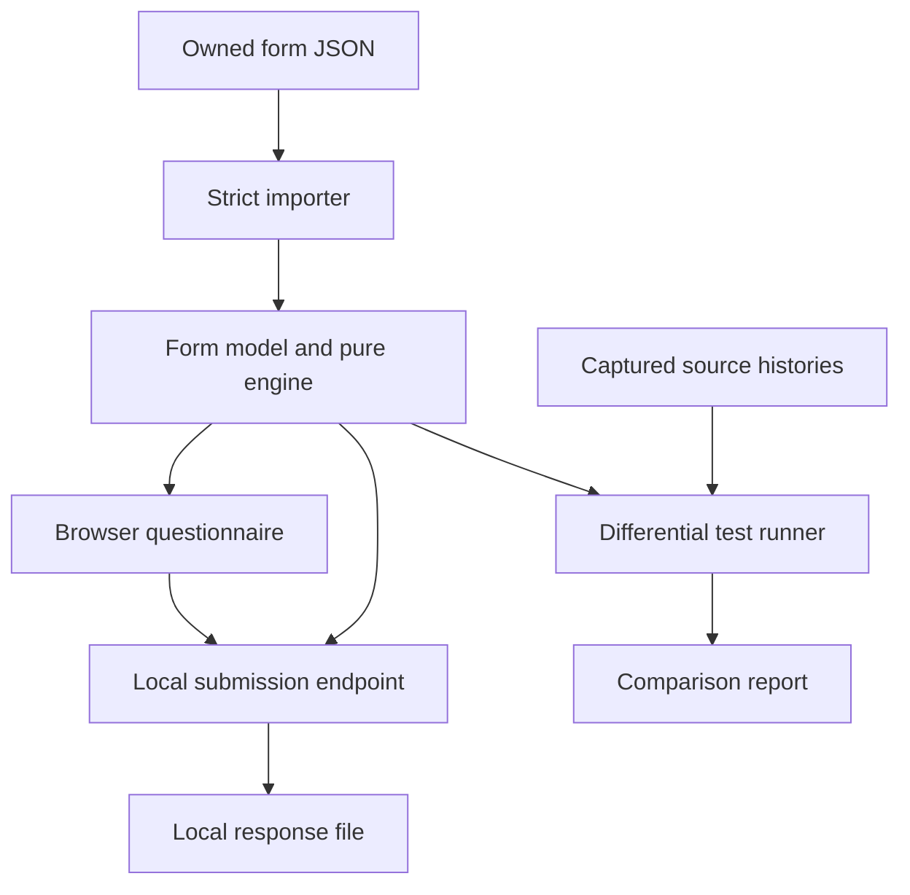

# FormLift: SDLC and implementation plan

Status: initial high-level SDLC baseline; planning only. Reviewed 31 October 2026.

The current detailed implementation contracts are in [DESIGN.md](DESIGN.md), [ACCEPTANCE.md](ACCEPTANCE.md), and [AGENT_WORKFLOW.md](AGENT_WORKFLOW.md). Start with [START_HERE.md](START_HERE.md) and use the canonical [PROMPT.md](PROMPT.md) for an implementation launch. These documents refine this baseline; follow their concrete interfaces, command semantics, and default evidence gate.

This plan develops finalist 1 from the three-hour strategy. Repository inspection found an empty public repository with no code, tests, license, open issues, or pull requests. No existing architecture needs to be preserved. The planning change introduces documentation only.

## 1. Initiation: the result we are trying to produce

**Product:** import an owned Typeform questionnaire and run its supported behavior locally, with a comparison report showing what survived the migration.

**User:** an organizer who wants to move a small branching questionnaire without silently changing answers when respondents go back and choose another branch.

**Research question:** when a respondent answers a conditional question, leaves that branch, and optionally returns, what is restored in the UI and what is included in the submitted or stored response?

**Honest claim:** independently reproduce observed behavior for a declared subset. The public JSON schema is documentation, not a discovery. The observed behavior may already be known elsewhere; credit it if found. Matching several traces does not reveal Typeform's internal implementation or establish general compatibility.

**Success:** genuine source artifact + controlled observations + independent engine + visible comparison + reproducible tests. No observations or passing results are claimed by this document.

## 2. Requirements and acceptance boundary

| ID | Required behavior | Acceptance evidence |
| --- | --- | --- |
| R1 | Import an actual owned form-definition JSON; do not ask the user to rewrite it into our schema | Original capture provenance, sanitized fixture, importer output |
| R2 | Support 3–6 fields: short text, number, and single-select choice | Supported-feature contract; unknown behavior rejected with a path and reason |
| R3 | Execute one captured branch predicate, forward progression, Back, and one ending | Direct Yes/No paths and changed-branch histories |
| R4 | Match observed restoration and submission behavior independently | Separate UI-restoration and response-content comparisons |
| R5 | Produce a local response through a Node endpoint and persist it | HTTP test and file read-back, including a write failure |
| R6 | Show import diagnostics, the runnable form, and a readable comparison result | One complete browser journey and 90-second demo |
| R7 | Make unsupported cases and unknown evidence visible | Rejections and skipped/unverified results cannot appear as passes |
| R8 | Release a reproducible, appropriately licensed subset | Clean install, exact test counts, notices, sanitized fixtures, limitations |

Mandatory initial fixture: Q1 single choice “Request a quote?” with Yes/No choices; Q2 number “Budget?” shown only on Yes; Q3 short text “Contact name” on both paths. Both paths share one ending. Example synthetic value: “Sample User”. Number constraints and required/optional settings must come from the captured form.

The original brief allowed two endings. That is a ceiling, not a promise: implement a second ending only when a real fixture requires it and it fits the same supported rule contract. Do not add another routing language to satisfy the ceiling.

The importer maps actual source field and choice identifiers to stable internal references. Do not hardcode question labels, IDs, sample values, or a fabricated export format. Verify changed labels/IDs with synthetic local tests and, if time permits, a second genuine owned export.

Use a two-option single-select source question for Yes/No; do not silently expand scope to a separate source `yes_no` type. Freeze an explicit policy for inert cosmetic metadata versus behavior-affecting features: known unused decoration may be ignored with a warning, while unsupported behavioral semantics must reject. Do not blindly reject every ordinary metadata/default field in a genuine export.

### Explicit exclusions

No builder, authentication, multi-user hosting, cloud deployment, database, analytics, scoring, payments, uploads, arbitrary expressions, third-party connectors, rich-text fidelity, or broad Typeform support. No runtime LLM calls. Refresh/resume, mobile polish, and production availability are outside the acceptance contract.

### Evidence prerequisites

The operator needs authorized access to a small live form, its real definition, and a way to observe reference behavior. No account, paid entitlement, API token, or response allowance is assumed to exist. Check the actual account before promising a demonstration. Keep credentials outside prompts, git, fixtures, and browser bundles.

Official documentation provides a form retrieval API and authenticated API access [S1, S4]. An export of response rows is not the form definition. If retrieval access or branching is unavailable, record the blocker rather than inventing an input.

The three-hour clock starts with target-specific evidence collection and setup in the implementation session. This planning work occurred beforehand; disclose that preparation if event rules count it. Confirm the actual hackathon rules before treating this as an eligible timed build. The original 24–48-hour and three-hour limits are planning constraints, not confirmed event rules.

## 3. Analysis: evidence before interface

Use [EVIDENCE_AND_TESTS.md](EVIDENCE_AND_TESTS.md) as the experiment protocol.

Test at least these alternatives:

- The abandoned answer is removed and does not reappear.
- The answer remains available when returning, but is excluded from a submission on the other branch.
- The answer remains available and is also included in that submission.

These are competing hypotheses, not an exhaustive description of all possible behavior. UI restoration, browser submission payload, and stored response are different observations. Do not infer one from another.

**Minute-20 gate:** obtain a real definition, an executable reference, a recorded changed-branch observation, and an accessible capture route that distinguishes the selected hypotheses. The default reference-mode launch requires a real response-content observation before the gate passes. A separately authorized UI-only investigation may support a narrower UI claim if response capture remains unavailable; it must not silently guess the submission policy.

The Responses API warns that recent results may be delayed by about 30 minutes [S3]. Do not spend the evidence window polling it. Prefer an existing authorized result capture, a readable owned-session submission trace, or an already available authorized webhook receiver. A webhook requires a reachable endpoint; localhost alone does not provide one. Do not build tunnel infrastructure as the default plan.

If the gate fails, stop the reverse-engineering track and report the missing input. A conventional local form prototype is a different deliverable. This FormLift work order does not silently switch to another finalist or reset the deadline.

## 4. Design: smallest useful architecture

Choose TypeScript for the shared pure engine and browser UI; a small Node HTTP server for local persistence; plain HTML/CSS; esbuild for a browser bundle; TypeScript tooling and the Node test runner. Pin the runtime and exact resolved dependency versions during implementation. Avoid a framework migration or introducing a database.

### Responsibilities and contracts

| Module | Input → output | Important constraint |
| --- | --- | --- |
| `src/importer.ts` | Unknown JSON → validated `FormModel` or structured errors | Derive mappings from a genuine artifact; reject unsupported semantics |
| `src/model.ts` | Shared type definitions | Freeze the small contract before parallel edits |
| `src/engine.ts` | Model + state + event → next state | Pure deterministic transitions; no DOM, disk, network, or LLM |
| `src/response.ts` | Terminal state → canonical answer result | Explicit policy based on observations, distinct from UI draft memory |
| `src/client.ts` | Form model + DOM events → rendered state and event history | Text-safe rendering, labels, keyboard-operable Next/Back |
| `src/server.ts` | Import and submission requests → validation/persistence | Fixed local routes; reuse engine replay, do not trust submitted answers |
| `tests/compare.ts` | Captured histories + engine → per-case differences | Expected source data independent from engine outputs |

Proposed internal model: ordered fields with stable refs and types, allowed choices and validation, one supported predicate plus its target, a default forward path, and captured ending identifiers. Final wire-to-model mapping is deliberately undecided until the real JSON is inspected.

Engine state separates current field, navigation history, draft answers, and terminal/submission state. Keep navigation history separate from the recomputed forward route: a visited-but-now-abandoned field is exactly what the experiment investigates. A small explicit policy captures the observed combination of restoration and submission behavior; do not bury it in rendering code.

Events: answer the current field, move Next, move Back, and Submit. Define invalid transitions and validation failures explicitly. Pure replay must drive tests and server validation using the same events. The UI dispatches these events; it must not implement a second routing algorithm.

### Local HTTP and storage contract

- `POST /api/import`: accept one bounded JSON definition, validate completely, return a server-generated definition hash and safe normalized model. A failed import must not partially replace the active model.
- `POST /api/responses`: accept the active definition hash and bounded event history. Replay against that model, require a valid terminal submission, derive answers on the server, append one complete JSONL record, and return success only after persistence succeeds.
- Bind to `127.0.0.1`; use fixed same-origin routes and a fixed local response path. This is a local demonstration, not a hosted API.
- One active model per server process. Reject submissions for a replaced model with a clear conflict error. No session database or account system.
- Proposed limits: definition 256 KiB, submission 64 KiB, six fields, 200 events. Validate type, references, branch targets, and event count. Reject cycles/unsupported routing. Keep imported text inert and never follow imported URLs.
- JSONL writes must be serialized and errors surfaced. Durability beyond successful local write, cross-process concurrency, and exactly-once submission are not claimed. Disable duplicate clicks in the UI; document that network retries may duplicate records.

### Proposed file layout — not existing implementation

`src/` contains the modules above; `public/` contains static assets; `tests/unit/`, `tests/integration/`, and `tests/fixtures/` contain implementation tests; `evidence/public/` contains sanitized source-derived fixtures; `evidence/private/` contains ignored raw captures; `reports/` contains generated comparison results. Keep runtime responses in ignored `data/`. Exact structure can simplify; acceptance cannot silently change.

## 5. Implementation: dependency-ordered work packages

These are proposed backlog tasks, not completed GitHub issues. Do not assign or notify other people automatically.

| Task | Deliverable | Depends on | Owner | Done when |
| --- | --- | --- | --- | --- |
| P0 | Evidence gate and actual supported subset | Operator access | Lead + operator | Real artifact, controlled observation, capture route, go/no-go recorded |
| P1 | Model, normalizer, fixture manifest, acceptance contract | P0 | Lead; QA reviews | Unknowns explicit; development/holdout split fixed |
| P2 | Strict importer and deterministic engine | P1 | Implementer | One captured history reproduces; unsupported cases reject |
| P3 | Minimal browser runner and local response endpoint | P2 contract | Implementer | Import → branch → Back → Submit → saved response works |
| P4 | Differential tests, boundary tests, report | P1; executes after P2/P3 | QA + implementer fixes | Every eligible case has actual result and evidence status |
| P5 | Clean-start verification and release package | P4 | Lead | Reproducible run, license/notices, limitations, measured demo costs |
| P6 | Demonstration | P5 | Operator + lead | 90-second source-versus-replacement rehearsal succeeds |

### Strict 180-minute schedule

| Elapsed minutes | SDLC focus | Exit condition |
| --- | --- | --- |
| 0–20 | Requirements validation and investigation | P0 passes; otherwise state blocker and narrow/stop the claim |
| 20–35 | Analysis, design, fixture contract | Frozen model, supported subset, independent test expectations |
| 35–65 | Core implementation | Strict importer + engine; one complete captured replay |
| 65–100 | Integration | Minimal UI and local endpoint; full import-to-persist journey |
| 100–140 | Verification and fixes | Run held-out source comparisons and failure cases; exact counts |
| 140–155 | Release readiness | Errors and comparison readable; clean-start rehearsal complete |
| 155–180 | Feature freeze, packaging, demonstration | README, compatible license, sanitized fixtures, report, demo |

At minute 60, one replay should run; at minute 90, the core journey must work. If either slips, cut optional endings, styling, and report visualization. Preserve the core evidence and test time. Do not add deployment. At minute 155, freeze features; fix only demo-blocking failures and disclose the rest. A late scope change does not restart the clock.

## 6. Agent execution plan

Use one lead coding session. Parallel agents help with independent evidence review and test design, not competing edits to the engine.

| Role | Authority and ownership | Handoff |
| --- | --- | --- |
| Human operator | Own account access, reference runs, fixture sanitization, demo | Supplies observations and identifies collection method; never sends secrets to a prompt |
| Lead / implementer | Owns `src/`, package configuration, integration, and time budget | Freezes contracts at minute 35; reports checkpoints and failures |
| Evidence analyst | Read-only source/docs review; can own experiment notes | Separates DOCUMENTED, OBSERVED, INFERRED, UNVERIFIED; reviews hypothesis coverage |
| QA agent | Owns test specification and independent expected data; later `tests/` | Runs blinded checks after core freeze; reports failing cases to lead |

In a two-agent session combine evidence and QA roles. Do not spawn separate frontend/backend/database/devops agents for this scope. No two agents edit shared files simultaneously. QA sends engine fixes to the lead rather than silently patching the system under test.

Use the repository's [CLAUDE.md](../CLAUDE.md) for the agent handoff. This planning turn does not start application implementation. The later implementation session records its own start and deadline and must pass P0; elapsed planning preparation remains disclosed separately.

## 7. Verification, release, and maintenance

The detailed matrix and comparison semantics are in [EVIDENCE_AND_TESTS.md](EVIDENCE_AND_TESTS.md). A local unit-test pass cannot substitute for source evidence. Holdout failures must remain visible even after repair; report original and post-fix results separately.

Planned command contract, to be implemented rather than assumed available now: `npm ci`, `npm run typecheck`, `npm test`, `npm run verify:reference`, and `npm start`. Reference verification must fail or clearly report BLOCKED when genuine captures are missing; zero cases is not success. A QA agent must verify the actual eventual command names in the README.

Release acceptance:

- A fresh install runs locally with no Typeform credentials and no runtime model API calls.
- The supported contract, exact reference-case counts, failures, skips, evidence channels, and normalized fields are published.
- A suitable explicit code license is present. Intended default is MIT for independently written code, subject to actual dependency compatibility; review the resolved licenses before release. Public visibility alone is insufficient.
- Only synthetic/consented, sanitized fixtures are committed. Raw credentials, account metadata, browser headers, and unrelated responses remain private. Attribute reused open-source code and assets.
- Record actual setup time, API/model build spend if available, runtime requests, startup/run latency, and local storage. Separate these from speculative monthly hosting and maintenance. A local prototype does not prove subscription-cancellation savings.
- Describe the closest practical alternative honestly. The value to demonstrate is verified migration behavior, not simply “we can render a form.”

After the hackathon, maintenance means adding a new source capture and regression case before expanding the compatibility contract. Pin observed fixture versions/hashes; investigate drift when a source behavior changes. Public deployment, authentication, durable storage, abuse controls, backups, and multi-user isolation require a separate design and budget.

## 8. Demo and first action

| Seconds | Show |
| --- | --- |
| 0–15 | Owned reference form, targeted workflow, and one explicit unknown |
| 15–35 | Import the genuine sanitized definition and complete a normal path |
| 35–60 | Answer Budget, backtrack, change branch, then demonstrate restoration separately |
| 60–80 | Compare actual source/replacement fields and response-content results; show the evidence channel |
| 80–90 | State supported scope, actual pass/fail count, limitation, and repository |

**Build first:** after obtaining the reference artifact, implement one importer-to-engine replay that reproduces a captured changed-branch history. Do not start with a landing page or a visual form builder.

## Sources checked for planning

- [S1: Typeform — retrieve form](https://www.typeform.com/developers/create/reference/retrieve-form/), checked 31 October 2026.
- [S2: Typeform — logic jumps](https://www.typeform.com/developers/create/logic-jumps/), checked 31 October 2026. Use this to understand documented routing; do not present its contents as reverse-engineering discoveries.
- [S3: Typeform — retrieve responses](https://www.typeform.com/developers/responses/reference/retrieve-responses/), checked 31 October 2026. Includes the recent-response delay warning.
- [S4: Typeform — personal access token](https://www.typeform.com/developers/get-started/personal-access-token/), checked 31 October 2026. API access and scoped credential handling.
- Prior brief: *Autonomous SG 2026 — Three-Hour Fable Strategy*, finalist 1 and execution plan, pages 9 and 12–16. This plan narrows the first demonstration to one ending and distinguishes UI restoration from submission contents.

